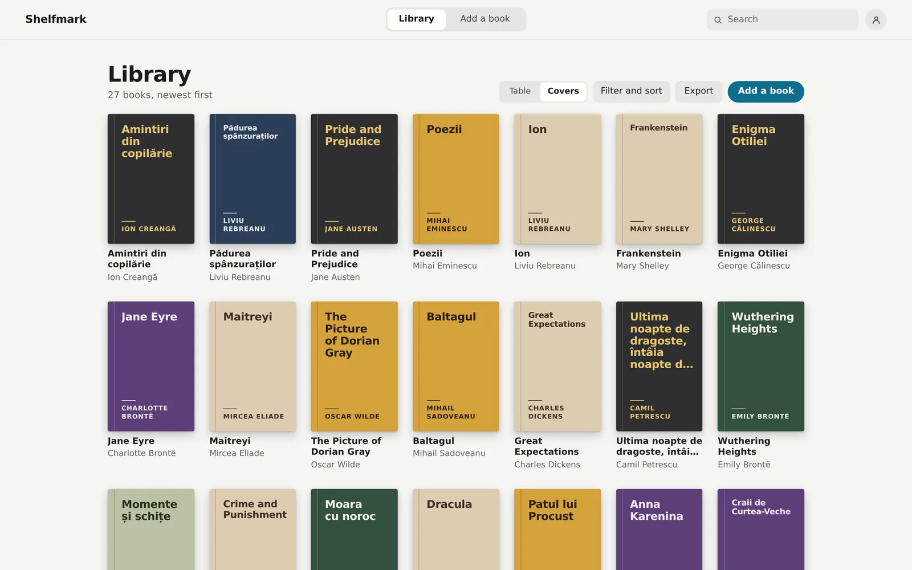
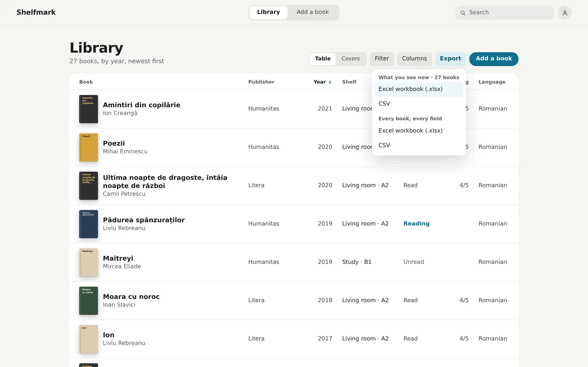
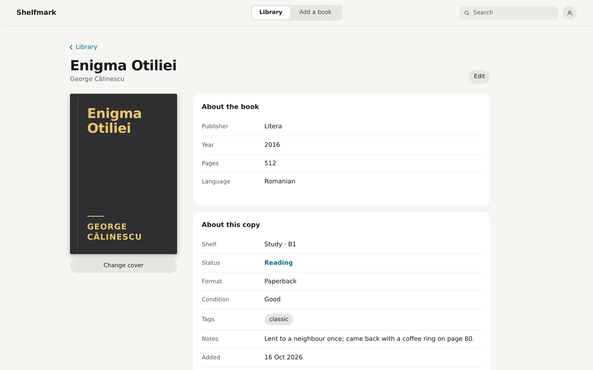
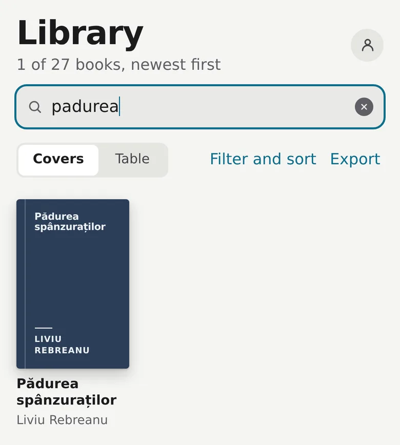
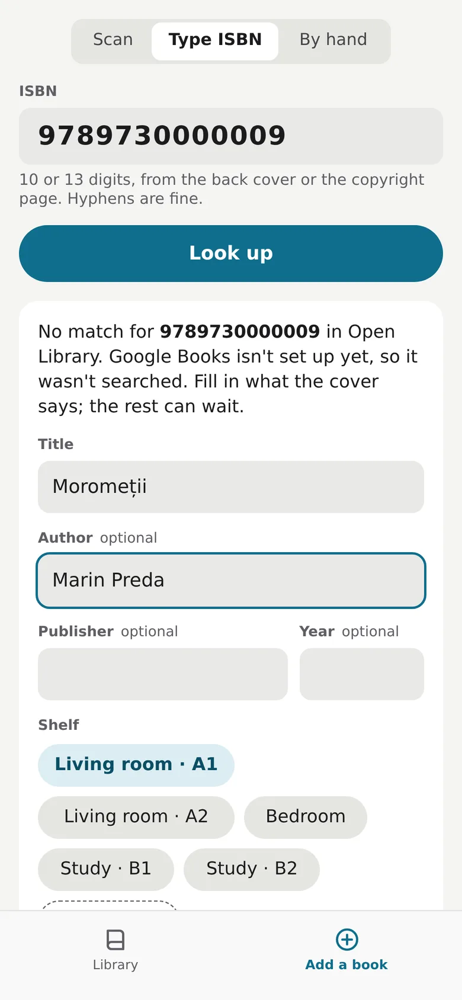
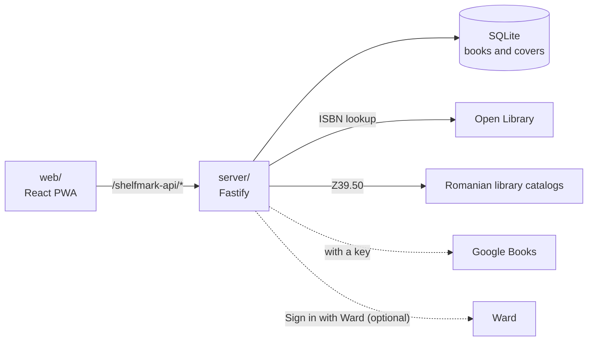

# Shelfmark

A catalog of the paper books on your shelves at home. Scan a barcode with your phone and the book lands in a table you can sort, filter and export to Excel or CSV. It's built for one person and a library that is mostly Romanian.

<p align="center">
  
</p>

**Status:** Personal project. Version 1 is built and reviewed and runs locally. It is not deployed yet, and the camera scanner and the home-screen install still wait to be tried on a real phone.

## What it does

- Adds a book from its barcode, through the phone camera, a typed ISBN or a USB barcode scanner on a laptop, and warns you when the book is already on your shelves.
- Looks the ISBN up in Open Library, then in three Romanian library catalogs (the Romanian Academy Library, BCU Cluj and BCU Timișoara), and last in Google Books if you give it a key. You confirm the draft before anything is saved. When the lookup finds nothing, a short form asks for what the cover says.
- Shows the library as a table or as covers, with a sort on several columns, a filter on each column, and search that ignores diacritics, so `padurea` finds *Pădurea spânzuraților*. The columns you show, hide, reorder and resize are remembered.
- Keeps your own details on every book: shelf, reading status, rating, tags, notes, format, condition, and where, when and for how much you got it.
- Exports the current view or every book to Excel or CSV, and downloads a full backup as one SQLite file, covers included.
- Installs to a phone's home screen. The app shell works offline.

Libib, BookBuddy and CLZ Books do much of this as hosted apps. Shelfmark keeps the whole library in one SQLite file on your own server, and you can export all of it at any time. It also expects most books to be typed in by hand. On 2026-10-14 the free ISBN databases found 12 to 20% of the Romanian ISBNs tried, against 92% of the English ones. There are no loans, reviews, friends, ebook files or price tracking, and there is one account.

## Screenshots

| The table, sorted by year, with the export menu open | A book page, with About the book and About this copy |
|---|---|
|  |  |

| Search ignores diacritics | The lookup found nothing, so you type what the cover says |
|---|---|
|  |  |

The screens show a made-up `demo` account with 27 classics. None has a cover file, so the app draws its own covers from the title and author. How each image was made: [docs/images/shots.md](docs/images/shots.md).

## How it works

Three npm workspaces. `shared` holds the zod schemas for every route, the book fields, and ISBN parsing and check digits. `server` is a Fastify API on SQLite. It runs the ISBN lookups through a queue and a cache, keeps covers in the database, and serves the backup. `web` is the React PWA. TanStack Table sorts and filters every book in the browser, so the table needs no server round trip. The scanner reads barcodes with the browser's BarcodeDetector, or with a ZXing build in WebAssembly where the browser has none. You sign in with a local account, or with [Ward](https://github.com/gandolh/ward-auth), the sign-in service the owner's other apps share.



More in [docs/architecture.md](docs/architecture.md).

## Run it locally

Requires Node 24 or later and npm.

```bash
npm install
cp .env.example .env                # optional, the defaults work
npm run seed -w @shelfmark/server   # asks for a username and password
npm run dev
```

Then open <http://localhost:5176/shelfmark/> and sign in with the account the seed created. The camera needs HTTPS, so to scan from a phone on the same network, use `npm run dev:https` instead. That command, the env vars and the tests are in [docs/getting-started.md](docs/getting-started.md).

## Project layout

| Path | What lives there |
|---|---|
| `shared/` | zod schemas for every route, the book fields, ISBN parsing |
| `server/` | Fastify API, SQLite store, lookup queue and cache, covers, backup, the vendored Ward auth library |
| `web/` | React PWA, served under `/shelfmark/` |
| `infrastructure/` | Dockerfile and compose file for the API container |
| `corpus/` | Project wiki, research, decisions and the numbered briefs |
| `docs/` | Setup, architecture, the owner's deploy steps and the images here |

## Docs

- [docs/](docs/README.md): setup, architecture, the owner's deploy steps, and the images used here
- [corpus/](corpus/index.md): the project wiki, with the research behind the features, the lookup hit rates, decisions and status
- [DESIGN.md](DESIGN.md): the design system as built; [PRODUCT.md](PRODUCT.md): who it is for and why

## License

No license yet; all rights reserved.
