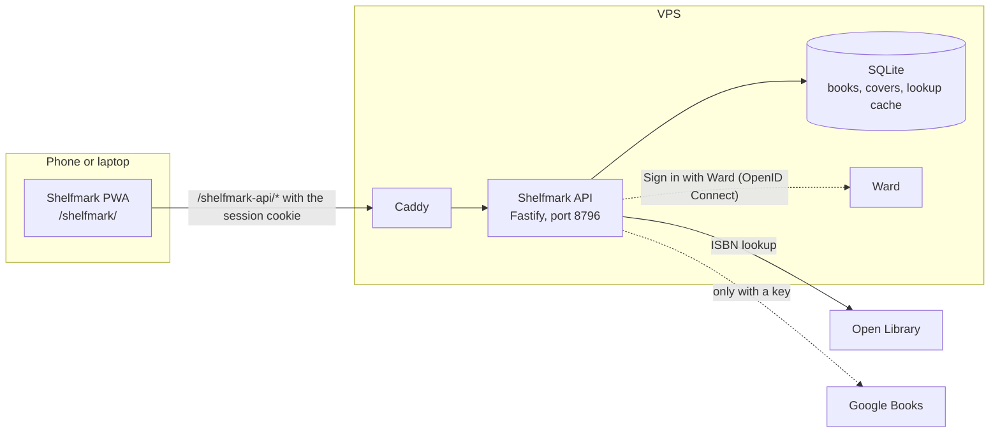

# Architecture

Shelfmark is three npm workspaces. `shared` holds the zod schemas for every
route, the book field definitions, and ISBN parsing and validation (ISBN-10
to 13, check digits); the other two import it. `server` is a Fastify API on
one SQLite file (better-sqlite3). Its store is the only code that runs SQL,
apart from the vendored Ward auth library. The server also owns the lookup
queue and cache, the covers (stored as BLOBs in the same database) and the
backup. `web` is the React PWA, served under `/shelfmark/`. It holds the
library table, the scanner, the book page and the export, and talks only to
the API. In production Caddy serves the PWA and forwards `/shelfmark-api/*`
to the API container with the prefix stripped, so the server's own routes
are `/api/*` and `/auth/*`. In development Vite does the same.

## Adding a book

1. The phone camera reads a barcode with BarcodeDetector, or with the ZXing
   WebAssembly polyfill where the browser has none. You can also type the
   ISBN, or let a USB scanner type it. `shared` checks the digits.
2. The web app sends `POST /api/lookup` with the ISBN.
3. The server answers from its cache, or asks Open Library and then Google
   Books, and returns a draft plus any book with that ISBN you already own.
4. If you own it, the app says so and offers "Open the book" or "Add another
   copy".
5. If the draft is good, you pick a shelf and a status and save it with
   `POST /api/books`. If the lookup found nothing, a short form asks for the
   title, and the rest can wait.
6. A cover found by the lookup is fetched from an allowed host and stored in
   the database. A book without one gets a cover drawn from its title and
   author.

The library then loads every book with `GET /api/books`, and TanStack Table
sorts, filters and searches them in the browser.

## Read more

- [corpus/wiki/architecture.md](../corpus/wiki/architecture.md): routes,
  request paths, ports, data and secrets
- [corpus/wiki/metadata-lookup.md](../corpus/wiki/metadata-lookup.md): the
  sources, their hit rates, the queue and the cache
- [corpus/wiki/scanning.md](../corpus/wiki/scanning.md): barcode reading,
  HTTPS and the iOS camera bug
- [corpus/wiki/library-table.md](../corpus/wiki/library-table.md) and
  [corpus/wiki/export.md](../corpus/wiki/export.md): the table and the
  exports
- [corpus/wiki/decisions.md](../corpus/wiki/decisions.md): what was decided
  and what was rejected
- Code: [shared/src/isbn.ts](../shared/src/isbn.ts),
  [server/src/lookup/](../server/src/lookup/),
  [server/src/routes/](../server/src/routes/),
  [web/src/add/](../web/src/add/), [web/src/library/](../web/src/library/)
